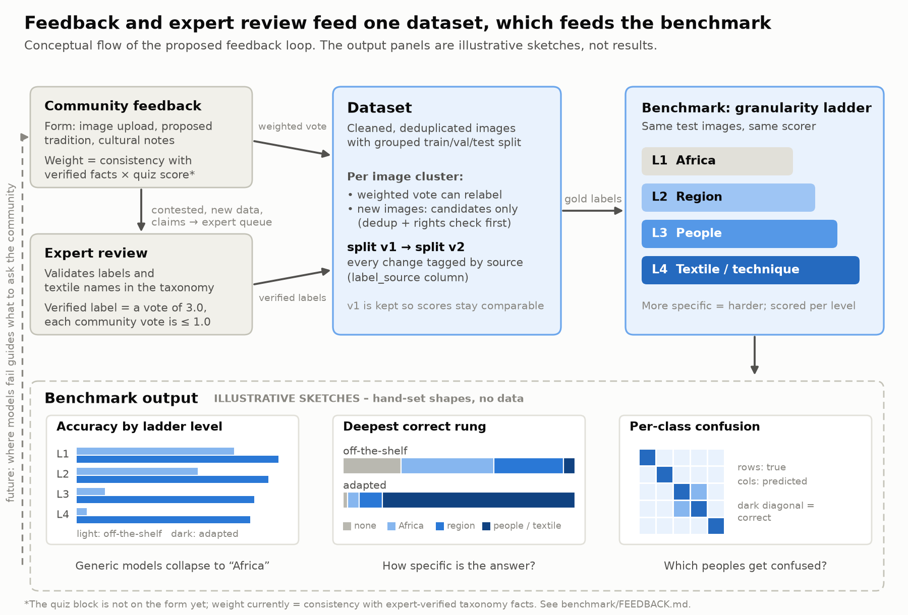

# Evaluating AI Representations of Cultural Textile and Style Expressions: A Benchmark and Community Feedback Loop

Off-the-shelf visual AI models fail in two ways when generating or interpreting images of textiles and fashion: substituting the general for the specific and a part for the whole. This repository contributes two pieces of trust infrastructure for that problem, with a proof of concept centered on African fashion:

1. **A benchmark for granular provenance.** The *granularity ladder* scores how specifically a vision model identifies a textile or garment, from "Africa" down to region, people and named technique. It separates a vague answer from a confidently wrong one.
2. **A community feedback mechanism.** Community members can correct labels or contribute images. Submissions are weighted by demonstrated knowledge rather than claimed identity, then combined with expert-verified labels in a weighted vote. Every resulting change is logged and versioned.

The models in this repository were trained to test the benchmark. They show that the gap it measures is real and can be closed. They could also contribute to a broader trust infrastructure, for example by classifying images from online retailers to provide provenance information on garments for sale in the global marketplace.

Dataset: [`inuwamobarak/african-atire`](https://huggingface.co/datasets/inuwamobarak/african-atire) (12,363 web images, 10 source labels, OpenRAIL).



## Contribution 1: the granularity ladder

Each image has a gold answer at four levels:

| Level | Example (an Adire cloth) |
|---|---|
| L1 Africa | African |
| L2 Region | West Africa |
| L3 People | Yoruba |
| L4 Textile / technique | Adire |

The gold answers come from `benchmark/taxonomy.yaml`, which a domain expert reviewed class by class. The scorer reports accuracy at each level and a "deepest correct rung" for each image. Rung 3 means the model named the people or the technique correctly. Rung 1 is split in two:

- **Monolithic collapse:** the model said only "African", or used a catch-all term such as "wax print", and named no region, people or technique.
- **Wrong-specific:** the model named a region, people or technique, but the wrong one.

The prompts never list the classes or mention Africa, so a model has to produce the answer itself. The full specification, scoring rules and worked examples are in [benchmark/BENCHMARK.md](benchmark/BENCHMARK.md).

### Results on the held-out test split (1,260 images)

| System | L1 Africa | L2 Region | L3 People | L4 Textile | Specific (rung 3) | Collapse to "Africa" |
|---|---:|---:|---:|---:|---:|---:|
| Qwen3-VL-4B, zero-shot | 77% | 62% | 14% | 5% | 13.9% | 0% |
| Gemma 4 E4B, zero-shot | 74% | 30% | 2% | 1% | 2.4% | 29% |
| DINOv2 linear probe | 100% | 95% | 87% | 87% | 87.5% | 0% |
| Qwen3-VL-4B, LoRA fine-tuned | 100% | 96% | 91% | 91% | 91.0% | 0% |
| Gemma 4 E4B, LoRA fine-tuned | 100% | 96% | 91% | 91% | 90.8% | 0% |

Sources: `results/report_assets/summary_models.json` and `tables/models_overall.csv`. Figures are in `results/report_assets/figures/`.

## Contribution 2: community feedback

The proposed intake is a public form. Each submission names the tradition it is about, includes an image upload, and can add cultural notes. The pipeline (`benchmark/feedback.py`, `scripts/14_feedback.py`) works as follows:

- **Linking.** Each upload is matched to a dataset image by perceptual hash, including rotated or mirrored copies. The vote then applies to the image's whole near-duplicate cluster. An upload that matches nothing becomes a candidate for new data.
- **Weighting.** Weight = consistency with expert-verified taxonomy facts × a knowledge-quiz score. A submission that contradicts a verified fact gets weight 0. The quiz score is a placeholder until the form has a question block. Self-reported credentials are recorded but never weighted. Both bad-faith test submissions in the sample described themselves as experts.
- **Voting.** The current label counts as one vote: 3.0 if the expert verified the class, 1.0 otherwise. A label changes only if the leading alternative has at least two distinct submitters with nonzero weight and a strictly larger total.
- **Versioning.** Changes are written to `data/splits/split_v2.csv` with a `label_source` column. `split_v1` is never edited, so earlier scores stay comparable.
- **Expert queue.** Contested labels, zero-weight submissions, new traditions and every free-text cultural claim go to an expert-review queue. The code does not judge them.

On the real five-row test export, all five uploads matched their dataset image. The submission claiming A'nger is a Yoruba cloth (the taxonomy has it as Tiv) got weight 0. A synthetic conflict set (`benchmark/feedback/synthetic_conflicts.csv`) exercises the decision rule: label changes, contested labels, an overturned expert label, a zero-weight vote that fails to tip the result, and a new-data candidate.

This is a basic demonstration, not a moderation system. The main gaps:
- The form has no quiz block yet.
- A false claim that names no taxonomy entity passes the consistency check. One bad-faith test, which describes Adire as Indian block printing, passed this way.
- There is no defence against one person submitting under several names.

The full design and list of gaps are in [benchmark/FEEDBACK.md](benchmark/FEEDBACK.md).

## What we learned

**The zero-shot failure was not the one we expected.** We built the benchmark to evaluate how accurately VLMs identify and classify culturally specific textile and style expressions across African traditions, particularly at the most granular enthic level. Gemma tends to collapse to the most generic output: 29% of its answers stop at "Africa", and 39% use a pan-African term such as "wax print". Qwen almost never collapses. It names a people, which is in line with the prompt instructions, but it is usually wrong. Qwen named "Yoruba" 592 times, and 525 of those were wrong. That flattens Nigerian textiles into the best-known Nigerian tradition rather than into "Africa." This is why the benchmark reports the wrong-specific rate separately from collapse.

**Recognition is uneven across communities.** Zero-shot Qwen named the people or technique correctly for 52% of Adire images and 49% of Zulu images, but for 2% or fewer of Idoma, Igala, Igbo, Tiv, Tswana-Shweshwe and Xhosa images. Per-class reporting is part of the benchmark for this reason.

**The gap closes with modest data.** A LoRA fine-tune of a 4B-parameter model on about 5,900 training images raised the specific rate from 13.9% to 91.0% (Qwen) and from 2.4% to 90.8% (Gemma). The two fine-tuned models are statistically tied (paired exact McNemar p = 0.82). A frozen DINOv2 linear probe reaches 87.5%, and fine-tuned Qwen beats it (p = 0.0003). This is a closed-set result: the fine-tuned models saw the same eight classes in training. It shows that specificity can be learned. It does not show open-world provenance identification.

**Label quality is the bottleneck, and one expert does not scale.** The expert confirmed that two source labels are misspellings ("Idgo" for Igbo, "Idama" for Idoma), supplied the textile names for each Nigerian people, and still has questions open on the Southern African classes. Deduplication removed 3,879 near-duplicate images and held 201 for review because copies of the same image carried different labels (66 clusters, most between Zulu, Xhosa and Tswana-Shweshwe). In total, a third of the source images were removed or held. These findings reinforce the need for the feedback mechanism.

## How the project evolved

1. **Benchmark first.** We drafted the ladder, the taxonomy and the scorer, then sent an Excel review pack of 50 images to the expert. The expert's answers merged two pairs of labels and gave the L4 textile names.
2. **Cleaning and splitting.** Perceptual-hash deduplication over eight orientations, with a colour check, showed the scale of duplication. The split groups near-duplicates by DINOv2 embedding (cosine ≥ 0.91), so copies of an image cannot land in both train and test. The expert-review images were forced into test.
3. **Baselines.** A DINOv2 linear probe gave a fixed-class reference. Building it exposed a flaw in the scoring: rung 1 mixed vague answers with confidently wrong ones, so it was split into collapse and wrong-specific.
4. **Vision-language models.** We scored Qwen3-VL-4B and Gemma 4 E4B zero-shot, then fine-tuned both with the same LoRA recipe. All five systems use the same split, prompt, decoding and scorer. Each results folder has a `run_meta.json` that pins the model, the prompt, and hashes of the split, taxonomy and code. Raw model outputs are kept, so scores can be recomputed without re-running models.
5. **Feedback loop.** After the label work, we built the community feedback pipeline and tested it on a sample export from the proposed form.

## Limitations

- The eight classes are mostly Nigerian and South African and do not represent the full diversity of the continent.
- L4 gold answers are class-level. The expert listed the textiles commonly used by each people, but we have not checked that each photo shows one of them.
- The Southern African classes (Tswana-Shweshwe, Xhosa-South Africa, Zulu) still have unverified taxonomy entries.
- The images are third-party web scrapes. Some show worn garments rather than flat textiles, and 345 kept images are under 128 px on the short side.
- The open-ended answer reader is rule-based. It does not handle negation and only recognises names in the taxonomy.

## Status of the gold labels

`benchmark/taxonomy.yaml` is version 0.1-draft.
- Adire, Idoma, Igala, Igbo and Tiv have expert-verified answers.
- The three Southern African classes are still drafts, and entries marked `TODO(expert)` are open questions.
- The source labels Idgo and Idama are merged into Igbo and Idoma, as the expert confirmed.

## Setup

```bash
curl -LsSf https://astral.sh/uv/install.sh | sh   # once
uv sync                                           # core + dev (Python 3.12)
uv sync --group vision                            # + DINOv2 classifier deps
uv sync --group vision --group vlm                # + Qwen / Gemma fine-tuning deps
```

Hugging Face downloads go to `data/hf_cache/`. The scripts set `HF_HOME` themselves. Run the tests with `uv run pytest`.

## Reproducing

| Step | Script | Output |
|---|---|---|
| Expert review pack | `scripts/01_fetch_and_sample.py` | `data/expert_review/expert_review.zip`, `results/class_counts.csv` |
| Clean and deduplicate | `scripts/02_clean_data.py`, `scripts/03_small_image_sample.py` | `data/clean/manifest.csv`, `results/dedup_report.md` |
| Embeddings and grouped split | `scripts/04_embeddings_and_splits.py` | `data/splits/split_v1.csv`, `results/split_report.md` |
| DINOv2 linear probe | `scripts/05_dinov2_probe.py` | `results/dinov2_probe/` |
| Dataset and probe report assets | `scripts/06_report_assets.py` | `results/report_assets/` (fig1-fig6, `summary.json`) |
| Qwen zero-shot / adapter evaluation | `scripts/07_qwen_zeroshot.py [--adapter DIR]` | `results/qwen3vl_4b_*` |
| Browsable review sheet | `scripts/08_review_sheet.py` | HTML of images with gold and model answers |
| Qwen LoRA fine-tune | `scripts/10_qwen_finetune.py` | `data/models/qwen3vl_4b_lora` |
| Model comparison report assets | `scripts/11_model_report_assets.py` | fig7-fig22, `summary_models.json` |
| Gemma zero-shot and LoRA fine-tune | `scripts/12_gemma_zeroshot.py`, `scripts/13_gemma_finetune.py` | `results/gemma4_e4b_*` |
| Feedback loop | `scripts/14_feedback.py --input CSV --run NAME [--apply]` | `results/feedback/NAME/`, optional `split_v2.csv` |
| Synthetic feedback set | `scripts/15_make_synthetic_feedback.py` | `benchmark/feedback/synthetic_conflicts.csv` |
| Concept figure | `scripts/16_feedback_concept_figure.py` | `fig23_feedback_concept.png` |

`scripts/09_backfill_run_meta.py` adds `run_meta.json` to results folders created before run metadata existed. To score any model's predictions with the benchmark:

```bash
uv run python -m benchmark.scorer --pred P.jsonl --gold G.jsonl --out results/run
```
